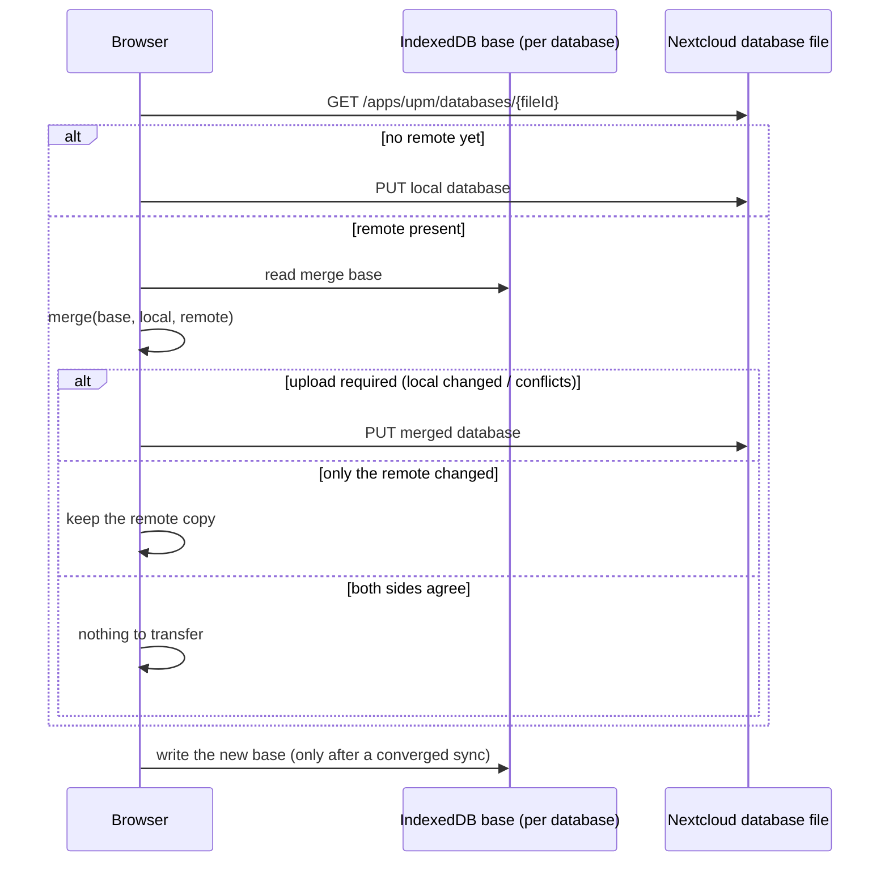

# UPM for Nextcloud

A password manager that runs **entirely in your web browser** and keeps its
encrypted database in your Nextcloud files. It reads and writes the same
database format as [Universal Password Manager](https://upm.sourceforge.net/)
(UPM), so your existing password databases open here unchanged.

## Your passwords never leave the browser

All encryption and decryption happens **on your device**. Nextcloud only ever
stores and forwards an opaque, encrypted file — it never sees your master
password or your passwords.

* The master password and the derived encryption key exist **only in your
  browser's memory**. They are never sent to the server, never logged, and are
  cleared when you lock the app or close the tab.
* The Nextcloud administrator — or anyone who breaches the server — sees only
  ciphertext. Without your master password the file is unreadable.
* Encryption matches the original UPM apps
  (`PBEWithSHA256And256BitAES-CBC-BC`: AES-256-CBC with a PKCS#12 key
  derivation, SHA-256, 20 iterations), so databases created by UPM open here,
  and vice versa.
* A wrong master password is rejected locally — nothing is transmitted.

## Compatibility with UPM

This app is a browser front-end for
[Universal Password Manager](https://upm.sourceforge.net/), the original
open-source password manager. It uses the same encrypted `.db` file format as
UPM's Android and desktop apps, so you can keep using them side by side and
sync the very same file.

## Sync

Sync merges your local database with the copy in your Nextcloud files instead of
overwriting one with the other. A three-way merge against the last-synced state
keeps edits from both sides; genuine conflicts are preserved as `"(remote)"`
copies so nothing is lost.



### Multiple databases

Keep any number of `*.db` files anywhere in your Nextcloud files. The picker
lists the files in your database folder, and other locations can be added by
path. A database is tracked by its Nextcloud **file id**, so renaming or moving
it in Files does not break the list. Each database has its own master password,
sync base and conflict backups; only one is unlocked at a time.

## Status

Work in progress. The crypto/format library, the Nextcloud backend and the
browser UI (database picker, unlock, edit, save, sync) are implemented;
hardening, packaging and end-to-end tests remain. See the phase-by-phase plan in
[`doc/implementation-checklist.md`](doc/implementation-checklist.md).

## Features

* Unlock and browse your accounts in the browser.
* Add, edit and delete accounts.
* Sync against the same `.db` file your UPM app uses — a three-way merge keeps
  edits from both sides and saves conflicts as copies.
* Keep several databases at any location in your files and switch between them.
* Export an encrypted copy of the database for backup.

## Development

Requires Node.js ≥ 20. On CachyOS/Arch, set up the toolchain with
`bash scripts/install-cachyos.sh`.

```bash
npm install        # install dev dependencies
npm test           # run the Vitest suite
npm run typecheck  # tsc --noEmit
```

The library lives in `src/`; tests live in `tests/`.

### Local Nextcloud instance

Start a throwaway Nextcloud 28 (SQLite, `admin` / `admin`) with this checkout
mounted as the `upm` app:

```bash
bash scripts/start-nextcloud.sh          # start, wait for install, enable UPM
bash scripts/start-nextcloud.sh --reset  # wipe the dev volume and start over
bash scripts/start-nextcloud.sh --stop   # stop, keep the data volume
bash scripts/start-nextcloud.sh --logs   # follow the container log
```

Then open <http://localhost:8080/index.php/apps/upm/>. The compose file is
generated into `.dev/` (git-ignored).

After frontend changes, run `bash scripts/build-frontend.sh` and reload with the
browser cache disabled — Nextcloud appends a fixed `?v=` cache-buster to
`js/upm.js`, so a plain reload can keep serving the old bundle. The script also
fails the build if `process.env.NODE_ENV` is left unresolved (Vite lib mode does
not replace it, and the browser has no `process`).

* Architecture & decisions: [`doc/plan.md`](doc/plan.md)
* Build plan: [`doc/implementation-checklist.md`](doc/implementation-checklist.md)
* Crypto reference (verified byte-for-byte): [`doc/crypto.md`](doc/crypto.md)

### Verifying the cryptography

The crypto layer is checked against the vectors in `doc/crypto.md` by the test
suite. An independent cross-check (pure Python + `openssl`, kept out of git
under `tmp/`) recomputes the same values from the bundled fixture
`scripts/test.db` (master password `test123`):

```bash
bash tmp/verify_kdf.sh
```

For that fixture it prints:

```
salt: ee95963f61e72735
key: 4fe00896368c69f9e3f3a79d3071dd8d09b5d582acec8e56742b0f4352728292
iv:  3c61f5bce260900a03de0f9e1083ab97
plaintext (53 bytes): 3030303132…000474657374
```
