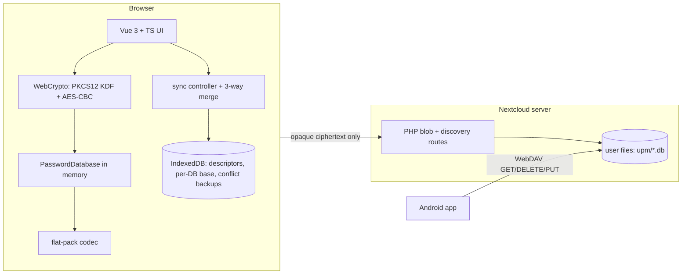

# UPM for Nextcloud — implementation plan

**Status:** draft for review
**Goal:** a Nextcloud app that opens UPM password databases with **all
decryption performed in the browser** — the server never sees the master
password or the derived key.

This plan is based on a full read of the reference Android implementation in
`../upm-android`. The domain knowledge it relies on has been copied into this
project (`.github/skills/`, `docs/`, `scripts/`) and the crypto has been
verified byte-for-byte against a real database (`doc/crypto.md`,
`tmp/verify_kdf.sh`).

> **Decision: Option A** (see §3). The step-by-step, low-cost-AI checklist is
> in [`doc/implementation-checklist.md`](implementation-checklist.md) (10 phases,
> 0–9, 10–21 steps each). Developer machine setup for CachyOS is automated by
> [`scripts/install-cachyos.sh`](../scripts/install-cachyos.sh).

---

## 1. What the Android app already does (summary of the analysis)

Universal Password Manager is a small password manager whose database is a
**single opaque, encrypted file**:

* **Format v3** — `UPM` magic (3 bytes) · version byte `0x03` · 8-byte salt ·
  AES-256-CBC ciphertext. The decrypted payload is a stream of
  length-prefixed UTF-8 fields (see `.github/skills/upm-database-format`).
* **Crypto** — BouncyCastle `PBEWithSHA256And256BitAES-CBC-BC`: a **PKCS#12
  KDF** with SHA-256, 20 iterations, 8-byte salt → 256-bit AES key + 128-bit IV.
  (Verified in `doc/crypto.md`.)
* **Sync** — download = plain `GET`, upload = WebDAV `DELETE` + `PUT`, Basic
  auth (app password with 2FA). Sync decides transfer by comparing the
  `Revision` integer stored inside the encrypted payload.
* **Conflict handling** — a **three-way merge** (`DatabaseMerger.java`): the
  base (last synced state) is compared with local and remote; neither side's
  edits are lost; conflicts are kept as `"name (remote)"` copies.
* **Relevant modules to port to TypeScript:**
  | Android | TS equivalent |
  |---|---|
  | `FlatPackObject`, `Revision`, `DatabaseOptions`, `AccountInformation` | flat-pack codec |
  | `EncryptionService` (PKCS#12 KDF + AES-CBC) | WebCrypto (`doc/crypto.md`) |
  | `PasswordDatabase` (load/save/version) | `PasswordDatabase` class |
  | `DatabaseMerger` (3-way merge) | `merge()` function |
  | `HTTPTransport` (WebDAV verbs) | `fetch` against the app/storage API |
  | `SyncDatabaseActivity` (sync flow) | sync controller |

---

## 2. Requirements

1. Runs **inside Nextcloud** as an app.
2. **Zero server-side knowledge of secrets**: the master password and the
   derived key exist only in the browser's memory; the PHP backend only ever
   stores and forwards the opaque ciphertext.
3. Written in **TypeScript**.
4. Reads/writes the same `upm.db` file the Android app syncs, so the two stay
   interoperable (same format, same revision semantics).
5. Preserves the Android app's sync safety: three-way merge, no silent data
   loss, conflict copies.
6. **Multiple databases**: the user can keep several `*.db` files at any
   location inside their Nextcloud files and switch between them. Each keeps
   its own revision stream, sync base and conflict backups.

---

## 3. Architecture options

### Option A — Nextcloud app, thin PHP backend (recommended)

A standard Nextcloud app: small PHP layer for storage + auth, a Vue/TypeScript
frontend that does all crypto in the browser.

* PHP exposes blob routes (read/write/delete by file id, create by path) plus a
  small discovery endpoint that lists `*.db` files, and a tiny "config/who-am-I"
  endpoint. It reads/writes the files via the Nextcloud filesystem API — **no
  WebCrypto, no password handling, no cryptography in PHP**.
* Pros: real Nextcloud integration, session/CSRF handled by the framework, no
  CORS, the app shows in the Nextcloud app menu, works behind SSO.
* Cons: more scaffolding (`appinfo/info.xml`, a few PHP files).

### Option B — pure static SPA, no PHP

Static Vue app talking straight to the WebDAV endpoint from the browser.

* Pros: simplest possible build.
* Cons: cross-origin WebDAV is not reliably CORS-enabled in Nextcloud; Basic
  auth from JS is awkward; no app-menu integration. **Not recommended.**

### Option C — Nextcloud app, storage in user files, frontend talks WebDAV directly

Same-origin `fetch` to `/remote.php/dav/files/…/upm.db` using the Nextcloud
session cookie (no PHP storage code at all), with a minimal PHP shim only for
config.

* Pros: less PHP than A.
* Cons: WebDAV verbs (PUT/DELETE) and CSRF need care; ties storage to WebDAV
  URL layout.

> **Recommendation: Option A.** It is the standard, robust approach, keeps the
> server-side attack surface minimal (a handful of file routes, all validating
> paths and permissions), and is the easiest to make correct with regard to
> authentication. Option C is a viable fallback if we want to avoid PHP storage
> code entirely.



The only bytes that ever cross the wire are the encrypted file. The master
password never leaves the browser.

---

## 4. Security model

* **Key never leaves the browser.** The password is read from an input field,
  converted to UTF-16BE, run through the KDF in JS, and used only inside
  `crypto.subtle` calls. It is not sent to the server, not logged, and cleared
  on lock/close.
* **Server sees only ciphertext.** PHP endpoints return/accept the opaque
  `upm.db` bytes. A compromised server can read the *file*, never the secrets.
* **Wrong password** is detected by AES-CBC padding failure (WebCrypto throws),
  exactly like Java's `BadPaddingException` → `InvalidPasswordException`.
* **Browser XSS is the real threat** for this design, so the frontend must:
  * ship no third-party analytics/ad scripts;
  * use a strict Content-Security-Policy;
  * pin dependencies and use Subresource Integrity;
  * auto-lock after inactivity and never persist the key to `localStorage`.
* Optional hardening (later): Web Worker so the key lives in a separate,
  shorter-lived JS realm; `finally { }`-style zeroing of `Uint8Array` buffers.

---

## 5. Storage & sync design

* **Database locations** — the encrypted `*.db` files live in the **user's
  files** (default `upm/upm.db`), so the Android app can keep syncing to the
  same file over WebDAV. Cross-device interoperability for free. The user may
  add any number of databases at any path inside their files.
* **Identity** — a database is identified by its Nextcloud **file id**, which is
  stable across renames and moves. Paths are used only to create a file and to
  display it; a rename in the Files app does not break the registry.
* **Registry** — the list of known databases (label, order, last opened) is
  kept **client-side** in IndexedDB. The server stays stateless and only lists
  the `*.db` files under the configured root; paths are not secret, but there
  is nothing worth persisting server-side.
* **Sync base** and **conflict backups** — per-browser state in **IndexedDB**,
  keyed by database id (`<fileId>:base`, `<fileId>:conflict-<timestamp>`), so
  they never leak into desktop sync and never mix between databases.
* **One active database** — only one database is unlocked at a time; switching
  re-locks, so at most one master password is held in memory.
* **Sync algorithm** — port `DatabaseMerger` exactly:
  1. GET remote file (404 → nothing remote yet).
  2. Decrypt remote with the current key.
  3. Load base from IndexedDB; decrypt.
  4. `merge(base, local, remote)` → merged + `uploadRequired` + conflict count.
  5. If upload required → re-encrypt merged (same salt) and PUT.
  6. After a converged sync, write the new base to IndexedDB.
  * Fallback when no base exists: last-writer-wins, with the losing side kept
    as an encrypted conflict backup (same as Android).
  * `DatabaseOptions` (remote location / auth entry) always come from the
    **local** database.

> The merge is a pure function over decrypted objects — it will be ported
> 1:1 from `DatabaseMerger.java` (see `docs/database-conflict-merge-plan.md`).

---

## 6. Proposed project structure

```
upm-nextcloud/
├── appinfo/
│   └── info.xml                 # Nextcloud app metadata
├── lib/                         # minimal PHP (blob storage + auth)
│   ├── AppInfo/Application.php
│   └── Controller/DbController.php
├── src/                         # TypeScript frontend
│   ├── crypto/
│   │   ├── kdf.ts               # PKCS#12 KDF (doc/crypto.md)
│   │   └── cipher.ts            # AES-CBC wrap
│   ├── format/
│   │   ├── flatpack.ts          # length-prefixed codec
│   │   ├── account.ts
│   │   ├── options.ts
│   │   └── passwordDatabase.ts  # load/save, revision
│   ├── merge/
│   │   └── merger.ts            # 3-way merge port
│   ├── storage/
│   │   ├── descriptor.ts        # database identity (file id, path, label)
│   │   ├── registry.ts          # known databases + last opened (IndexedDB)
│   │   ├── remote.ts            # blob routes by file id + discovery
│   │   └── syncBase.ts          # IndexedDB base/backups, keyed per database
│   ├── sync/
│   │   └── syncController.ts
│   ├── ui/                      # Vue components (unlock, list, edit, sync)
│   └── main.ts
├── doc/                         # this plan + crypto reference + checklist
│   ├── plan.md
│   ├── crypto.md
│   └── implementation-checklist.md
├── docs/                        # copied Android design docs
├── scripts/                     # copied test helpers + fixtures
│   ├── install-cachyos.sh       # CachyOS/Arch developer setup
│   ├── webdav-test.py
│   ├── webdav-test-server.py
│   ├── test.db
│   └── test.db.password
└── tmp/                         # verification scripts
```

---

## 7. Milestones → phases

The detailed, executable breakdown lives in
[`doc/implementation-checklist.md`](implementation-checklist.md). Summary:

| Phase | Scope | Checklist |
|---|---|---|
| 0 | Repo & toolchain scaffolding | steps 0.1–0.12 |
| 1 | Crypto (PKCS#12 KDF + AES-CBC) | 1.1–1.14 |
| 2 | Flat-pack codec | 2.1–2.10 |
| 3 | Data model (`PasswordDatabase` et al.) | 3.1–3.14 |
| 4 | Three-way merge port | 4.1–4.14 |
| 5 | Nextcloud PHP backend (dumb, crypto-free) | 5.1–5.16 |
| 6 | Vue frontend shell | 6.1–6.16 |
| 7 | Sync + IndexedDB base/backups | 7.1–7.16 |
| 8 | Hardening, e2e tests, packaging | 8.1–8.14 |
| 9 | Multiple databases (descriptors, per-DB sync state) | 9.1–9.21 |

All accepted suggestions are folded in: pure-TS library first (phases 1–4),
`scripts/test.db` golden fixture (phases 1/3), db in user files (phase 5),
verbatim merge port (phase 4), dumb PHP (phase 5), Web Worker (phase 8,
optional), export button (phase 6), WebDAV test scripts (phases 7–8),
file-id identity with a client-side registry (phase 9).

---

## 8. Risks

| Risk | Mitigation |
|---|---|
| KDF mismatch between JS and Java | Already de-risked: byte-for-byte verified (`doc/crypto.md`, `tmp/verify_kdf.sh`) |
| WebCrypto not available (HTTP, old browser) | Require HTTPS; show clear error; WebCrypto is ubiquitous on modern browsers |
| Key in memory after lock | Zero buffers, auto-lock timer, never persist key |
| WebDAV vs app storage divergence | App storage uses the same user file, so Android and web share one source of truth |
| Renamed/moved database file | Identity is the Nextcloud file id, not the path; the list endpoint refreshes paths |
| Read-only shared folders | The list endpoint reports `canWrite`; open such databases read-only and refuse PUT |
| Concurrent edits (two tabs, same database) | Per-database revision + three-way merge; `If-Match`/ETag and `navigator.locks` deferred (see checklist Phase 9) |
| IndexedDB growth across many databases | One base per database plus a capped number of conflict backups |

---

## 9. Suggestions

1. **Start with M1 + M2 as a pure TypeScript library** (Vite + Vitest), fully
   testable without Nextcloud. It mirrors the Android unit-test approach and
   makes the crypto/merge provable before any PHP exists.
2. **Reuse `scripts/test.db` as the golden fixture** for round-trip tests
   (decrypt → identical plaintext → re-encrypt → byte-identical file).
3. **Keep the database in the user's files** (not appdata), so the existing
   Android app and the new web app sync to the same file via WebDAV.
4. **Port `DatabaseMerger` verbatim** rather than inventing a new merge —
   the Android side already fixed the hard cases (delete-vs-edit, both-edited,
   `(remote)` suffix, revision bump).
5. **Make the PHP layer deliberately dumb** (two endpoints, no crypto) so the
   "server never sees the key" property is easy to audit.
6. Consider a **Web Worker** for the KDF/decrypt so long operations never block
   the UI and the key lives in a more isolated realm.
7. Add a **"Download encrypted copy" / "Export"** button — cheap to implement
   once the blob is in memory, and good for disaster recovery.
8. Use the copied `scripts/webdav-test.py` / `webdav-test-server.py` for
   end-to-end sync testing against a throwaway WebDAV server before hitting a
   real Nextcloud.
9. **Identify databases by Nextcloud file id, not by path**, and keep the
   descriptor registry client-side. It survives renames/moves without any
   server state, and keeps the "server only stores the file" property intact.
